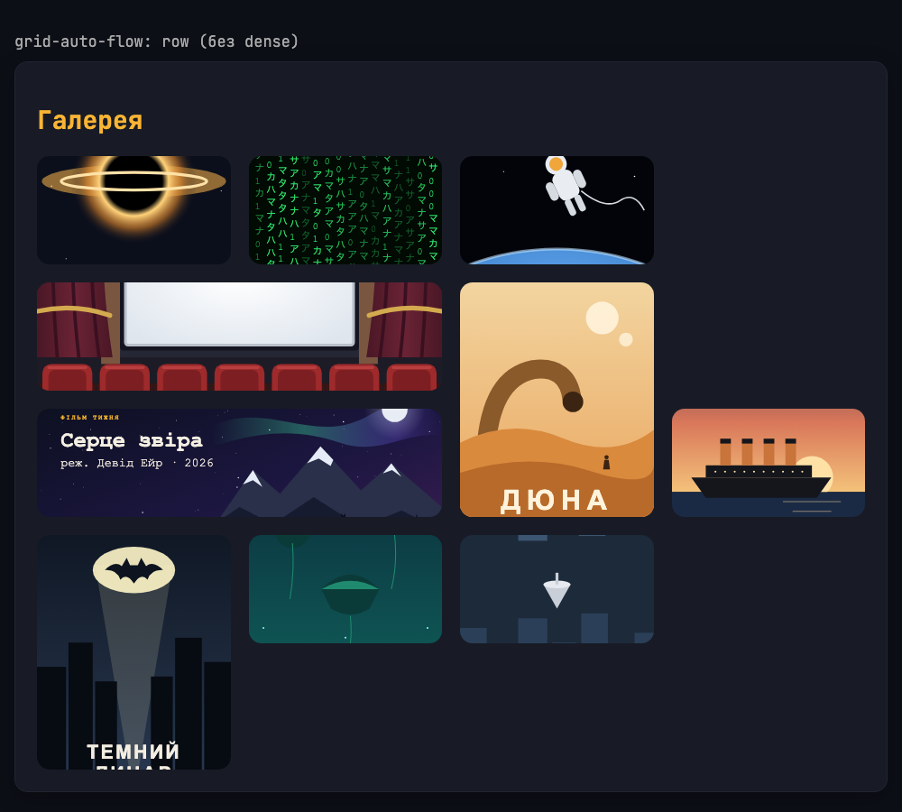
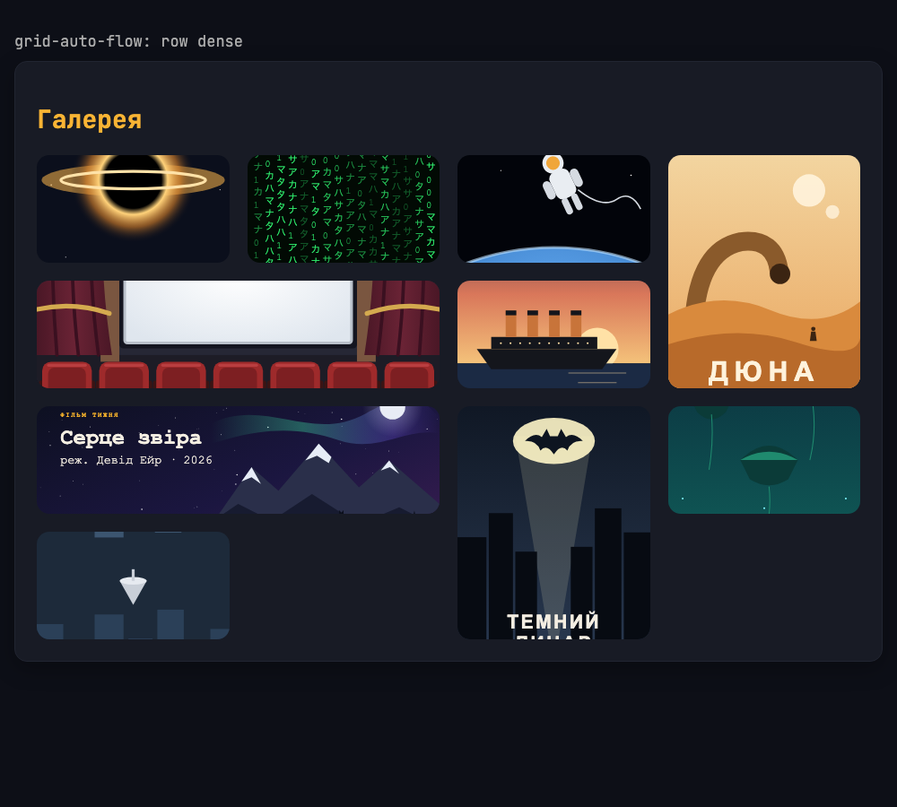

# web-course-2

Сайт кінотеатру «Кіносвіт», варіант 4.

## Оформлення

- **Шрифт:** одна гарнітура JetBrains Mono (400 і 700, з кирилицею), підключена через `@import` з Google Fonts; запасний — системний `monospace`.
- **Палітра «кінозал»:** темний фон `--color-bg`, золотистий акцент `--color-accent`, окремі кольори для рейтингу (`--color-rating`) і тривалості (`--color-duration`), а також кольори станів посилань і полів форми. Усі кольори — змінні в `:root`.
- **Розміри:** шкала відступів `--space-xs` … `--space-xl`, `--container-width`, `--radius`, `--shadow`; для макета (LR6) — `--gap`, `--min-col`, `--sidebar`.
- **Найскладніший селектор:** підсвітка рядка таблиці під курсором. Комірка з `rowspan` належить лише першому рядку, тому для нижчих рядків довелося писати ланцюжки на кшталт `tbody tr:has(+ tr + tr:hover) > td[rowspan]:not([rowspan="2"])`.

## Бонусні завдання LR4

1. **Світла тема** — блок `body.light-theme` перевизначає ті самі змінні. Більше нічого міняти не треба, бо всі правила беруть кольори через `var(--…)`.
2. **`:has()`** — `#concept article:has(img)` дає акцентну рамку картці з картинкою. Без `:has()` довелося б уручну ставити окремий клас.
3. **Нюморфізм** — блок порад має фон як у сторінки і дві протилежні тіні; на `:active` вони стають `inset`. Якщо фон блока відрізнятиметься від фону сторінки, ілюзія рельєфу зникне.
4. **Вкладеність** — `legend` описано всередині `fieldset`, варіанти підписів — усередині `label` через `&`. Усе про один елемент зібрано в одному місці.
5. **`::marker`** — змінює справжній маркер (і сам рахує номери), але підтримує лише колір, шрифт і `content`. `::before` дає повну свободу, проте маркер і нумерацію доводиться робити вручну.

## object-fit

Перевірено на вертикальному постері «Серце звіра» в рамці 100% × 170px:

- **`fill`** — пропорції не зберігаються: постер сплющився, місяць став овалом.
- **`contain`** — картинка вміщується цілком зі збереженням пропорцій, тому вона вужча за рамку, і з боків лишаються порожні поля.
- **`cover`** — рамка заповнена без спотворень, але зайве обрізається: у вертикального постера — верх і низ.

Постери — SVG, тому для чесного експерименту їм додано `preserveAspectRatio="none"`, інакше при `fill` вони не розтягувалися б.

## Три крапки

- **Без `white-space: nowrap`** — назва переноситься на кілька рядків, обрізати нічого.
- **Без `overflow: hidden`** — текст вилазить за межі заголовка, трьох крапок немає.
- **Без `text-overflow: ellipsis`** — назва в один рядок, але обривається посеред літери без «…».

## Схлопування відступів

Вертикальні `margin` сусідніх блоків (а також батька й першого чи останнього нащадка без `padding` чи `border` між ними) не додаються, а зливаються в більший: 24px і 16px дають 24px. У `inline-block`, flex- і grid-елементів, а також по горизонталі цього не буває. Правило, щоб не стикатися: задавати вертикальні відступи лише в один бік — тут тільки `margin-bottom`.

## Бонусні завдання LR5

1. **`fixed` проти `sticky`.** Кнопка «нагору» з `fixed` прив'язана до вікна і повністю виходить із потоку. Липка шапка лишається в потоці й «прилипає» лише при прокручуванні, у межах свого батька. Оскільки липка шапка завжди видна, перехід на `#top` майже не прокручував сторінку, тож шапці додано великий `scroll-margin-top`.
2. **«Скляна» картка.** У картки «Дюна» три фонові шари. Найвище — перший у списку, напівпрозорий градієнт, під ним фото зали, а внизу суцільний колір. Колір у `background` дозволено лише в останньому шарі, бо він завжди малюється під усіма зображеннями.
3. **`clamp()`.** Заголовок плавно змінюється від 1.6rem до 3rem разом із шириною вікна. Одне правило замість трьох медіазапитів дає плавну зміну без стрибків, і не треба вгадувати точки переходу.
4. **Два рядки.** `text-overflow: ellipsis` працює лише з одним рядком, бо потребує `nowrap`. `-webkit-line-clamp: 2` дає тексту переноситися і ставить «…» в кінці другого рядка.
5. **Контекст накладання.** `transform` на `.cards` створює власний контекст накладання (stacking context). Зовні нічого не змінюється, бо шапка з `z-index: 10` і так вища, але `z-index` бейджів тепер діє лише всередині `.cards`. Тому навіть 9999 не підняв би бейдж над шапкою: назовні весь блок — один шар на рівні 0.

## Адаптивна сітка

Картки каталогу тепер у сітці `repeat(auto-fit, minmax(var(--min-col), 1fr))` із `gap: var(--gap)`. Ширина колонки — щонайменше 240px, проміжок — 20px. Перебудова при зменшенні ширини вікна:

- **4 → 3 колонки** — приблизно на **1100px**;
- **3 → 2 колонки** — приблизно на **840px**;
- **2 → 1 колонка** — приблизно на **565px**.

Медіазапитів для цього немає: браузер сам ділить ширину контейнера на мінімальну ширину колонки з урахуванням проміжків. Наприклад, чотири колонки потребують 4 × 240 + 3 × 20 = 1020px контейнера, а це якраз вікно ~1100px мінус поля сторінки й секції. Щойно місця на ще одну колонку `--min-col` не вистачає, вона зникає, а решта ділять вільне місце порівну завдяки `1fr`.

**`auto-fill` замість `auto-fit`** (дві картки на широкому екрані): `auto-fill` лишає порожні колонки, тож дві картки займають лише дві чверті рядка по ~248px, а `auto-fit` згортає порожні колонки, і дві картки розтягуються на всю ширину по ~515px.

## Areas

Макет `catalog.html` описано через `grid-template-areas`: `"nav main side"` і `"foot foot foot"`. Коли в схемі поміняти місцями `nav` і `side`, рубрики й фільтр за жанром міняються колонками, а HTML лишається тим самим. Це доводить, що розмітка відповідає лише за зміст і порядок елементів, а їхнє місце на екрані повністю задає CSS: щоб перебудувати макет, досить переписати схему зон.

## Sticky і Grid

Липкий елемент «їздить» лише в межах свого батька. Якщо занести `<header>` усередину `.layout`, він стає звичайною клітинкою сітки висотою з саму шапку, і їздити йому ніде: я перевірив — після прокручування шапка лишилася на своєму місці в сітці і зникла з екрана. Тому `<header>` стоїть поза `.layout`, прямо в `<body>`, і липне на всіх сторінках, а сітка описує лише зони `nav`, `main`, `side` і `foot`.

## dialog

У першій картці каталогу («Серце звіра») є кнопка «Швидкий перегляд», яка відкриває `<dialog>` з описом фільму та його акторським складом, а також кодом сеансу, режисером, роком, тривалістю й жанром. Перевірено:

- **Esc** закриває вікно — це вміє сам `<dialog>`, відкритий через `showModal()`, без жодного коду.
- **Прокручування позаду.** Сам `<dialog>` його не блокує: коліщатко над затемненням гортало каталог. Тому додано правило `html:has(dialog:modal) { overflow: hidden; }` — поки вікно відкрите, сторінка позаду не прокручується.
- **Затемнення тла** я не створював окремим елементом: його малює псевдоелемент `::backdrop`, який браузер сам додає під модальним вікном.

## Бонусні завдання LR6

1. **Перемикач теми.** Кнопка «Тема» в меню вмикає й вимикає клас `light-theme` на `<body>`. Сайт за замовчуванням темний, тому другою темою зроблено світлу. Сама тема — лише блок `body.light-theme` з перевизначеними змінними палітри, жодне правило оформлення не продубльоване: усі правила беруть кольори через `var(--…)`. Числами лишилися тільки напівпрозорі тіні й затемнення, однаково придатні для обох тем.
2. **Щільна галерея.** На головній є галерея з чотирьох колонок: два кадри широкі (`span 2` по колонках), два високі (`span 2` по рядках).

   | без `dense` | з `dense` |
   |---|---|
   |  |  |

   Без `dense` широкий кадр зали не влазить у кінець першого рядка і переходить на наступний, а в рядку лишається дірка; галерея виходить вищою (680px проти 540px). З `dense` браузер заповнює дірки кадрами, що стоять у HTML пізніше. Плата за це — візуальний порядок перестає збігатися з порядком у HTML: «Дюна», п'ята в коді, стоїть четвертою, а «Титанік» — раніше за кадр із банером. Для клавіатури (Tab) і екранної читалки порядок лишається HTML-ним, тож людина, яка дивиться і водночас перемикається Tab, бачить, що фокус «стрибає».
3. **Закріплена картка.** «Дюна» (хіт прокату) у HTML — четверта, але завдяки `order: -1` і `grid-column: 1 / -1` стоїть першою на весь ряд. Так можна лише виділяти, а не виправляти неправильний порядок: екранна читалка й клавіатура йдуть за HTML і для них «Дюна» так і лишається четвертою. Якщо порядок у змісті неправильний, його треба виправляти в розмітці.
4. **Липка бічна колонка.** Фільтр за жанром має `position: sticky; top: 9rem; align-self: start` і зупиняється під шапкою. Без `align-self: start` липкість зникає: грид-елемент за замовчуванням розтягується на всю висоту своєї області — тут на весь рядок із каталогом (~9500px), тож він уже займає все місце і «їздити» в межах області йому нікуди.
5. **Форма у дві колонки.** Форму з LR3 перебудовано на Grid без зміни розмітки: кожен `fieldset` — сітка `var(--label-col) 1fr`, абзаци навколо пар «підпис + поле» стали `display: contents`, тож підписи стоять ліворуч, поля праворуч, а кнопки розтягнуті на обидві колонки (`grid-column: 1 / -1`). На звичайному потоці кожен підпис стояв над полем і форма була майже вдвічі довшою. Це коштувало 25 рядків CSS і ще 8 для телефона, де форма знову в одну колонку.

## Сітка в DevTools

На скріншоті в DevTools увімкнено значок grid біля `display: grid` для `.layout` і `.cards`: видно три колонки макета (рубрики, каталог, фільтр за жанром), рядок підвалу і колонки сітки карток із номерами ліній.

У `styles.css` не лишилося `float` (буквицю в «Наших залах» тепер робить `initial-letter`) і `inline-block` для розкладки; кожен `gap` і кожна ширина треку сітки задані через `var()`.

## Перевірка валідатором W3C

| Сторінка | Errors до | Errors після |
|---|---|---|
| `index.html` | 0 | 0 |
| `catalog.html` | 0 | 0 |
| `form.html` | 0 | 0 |
| `about.html` | 0 | 0 |

## Меню без JS

Головне меню в шапці загорнуто в `
`: на телефоні видно лише кнопку «☰ Меню», а від 768px — звичайний ряд пунктів. `
` кращий за «чекбокс-трюк» з `:checked`, бо це справжній інтерактивний елемент: `summary` сам отримує фокус клавішею Tab, розкривається Enter або Space, а екранна читалка оголошує, згорнуто меню чи розгорнуто; прихований чекбокс з `label` усього цього не вміє без додаткових атрибутів і хитрощів зі стилями. У `
` немає атрибута `open`, тож на телефоні меню відкривається згорнутим і липка шапка не закриває пів екрана, а на широкому екрані список показано через `::details-content`. Коли в темі 9 меню буде на JavaScript, кнопка перемикатиме клас або атрибут `aria-expanded` на `<nav>`, тож можна буде, наприклад, закривати меню після вибору пункту чи кліку поза ним і анімувати розгортання — цього `
` без скрипту не вміє.
