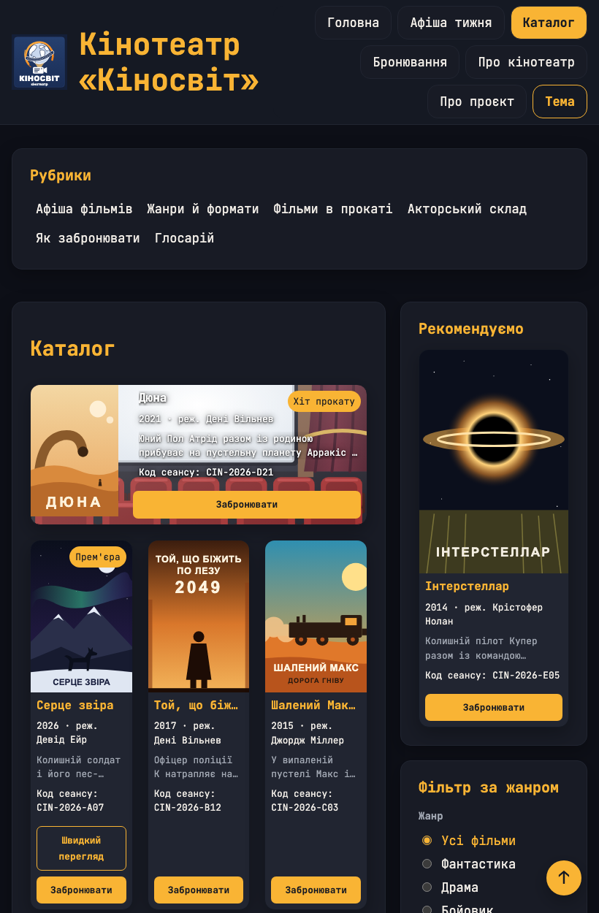

# web-course-2

Сайт кінотеатру «Кіносвіт», варіант 4.

## Оформлення

- **Шрифт:** одна гарнітура JetBrains Mono (400 і 700, з кирилицею), підключена через `@import` з Google Fonts; запасний — системний `monospace`.
- **Палітра «кінозал»:** темний фон `--color-bg`, золотистий акцент `--color-accent`, окремі кольори для рейтингу (`--color-rating`) і тривалості (`--color-duration`), а також кольори станів посилань і полів форми. Усі кольори — змінні в `:root`.
- **Розміри:** шкала відступів `--space-xs` … `--space-xl`, `--container-width`, `--radius`, `--shadow`; для макета (LR6) — `--gap`, `--min-col`, `--sidebar`.
- **Найскладніший селектор:** підсвітка рядка таблиці під курсором. Комірка з `rowspan` належить лише першому рядку, тому для нижчих рядків довелося писати ланцюжки на кшталт `tbody tr:has(+ tr + tr:hover) > td[rowspan]:not([rowspan="2"])`.

## Бонусні завдання LR4

1. **Світла тема** — окремий блок перевизначає ті самі змінні (у LR7 тема ще й береться з налаштувань системи, див. «Бонусні завдання LR7»). Більше нічого міняти не треба, бо всі правила беруть кольори через `var(--…)`.
2. **`:has()`** — `#concept article:has(img)` дає акцентну рамку картці з картинкою. Без `:has()` довелося б уручну ставити окремий клас.
3. **Нюморфізм** — блок порад має фон як у сторінки і дві протилежні тіні; на `:active` вони стають `inset`. Якщо фон блока відрізнятиметься від фону сторінки, ілюзія рельєфу зникне.
4. **Вкладеність** — `legend` описано всередині `fieldset`, варіанти підписів — усередині `label` через `&`. Усе про один елемент зібрано в одному місці.
5. **`::marker`** — змінює справжній маркер (і сам рахує номери), але підтримує лише колір, шрифт і `content`. `::before` дає повну свободу, проте маркер і нумерацію доводиться робити вручну.

## object-fit

Перевірено на вертикальному постері «Серце звіра» в рамці 100% × 170px:

- **`fill`** — пропорції не зберігаються: постер сплющився, місяць став овалом.
- **`contain`** — картинка вміщується цілком зі збереженням пропорцій, тому вона вужча за рамку, і з боків лишаються порожні поля.
- **`cover`** — рамка заповнена без спотворень, але зайве обрізається: у вертикального постера — верх і низ.

Постери — SVG, тому для чесного експерименту їм додано `preserveAspectRatio="none"`, інакше при `fill` вони не розтягувалися б.

## Три крапки

- **Без `white-space: nowrap`** — назва переноситься на кілька рядків, обрізати нічого.
- **Без `overflow: hidden`** — текст вилазить за межі заголовка, трьох крапок немає.
- **Без `text-overflow: ellipsis`** — назва в один рядок, але обривається посеред літери без «…».

## Схлопування відступів

Вертикальні `margin` сусідніх блоків (а також батька й першого чи останнього нащадка без `padding` чи `border` між ними) не додаються, а зливаються в більший: 24px і 16px дають 24px. У `inline-block`, flex- і grid-елементів, а також по горизонталі цього не буває. Правило, щоб не стикатися: задавати вертикальні відступи лише в один бік — тут тільки `margin-bottom`.

## Бонусні завдання LR5

1. **`fixed` проти `sticky`.** Кнопка «нагору» з `fixed` прив'язана до вікна і повністю виходить із потоку. Липка шапка лишається в потоці й «прилипає» лише при прокручуванні, у межах свого батька. Оскільки липка шапка завжди видна, перехід на `#top` майже не прокручував сторінку, тож шапці додано великий `scroll-margin-top`.
2. **«Скляна» картка.** У картки «Дюна» три фонові шари. Найвище — перший у списку, напівпрозорий градієнт, під ним фото зали, а внизу суцільний колір. Колір у `background` дозволено лише в останньому шарі, бо він завжди малюється під усіма зображеннями.
3. **`clamp()`.** Заголовок плавно змінюється від 1.6rem до 3rem разом із шириною вікна. Одне правило замість трьох медіазапитів дає плавну зміну без стрибків, і не треба вгадувати точки переходу.
4. **Два рядки.** `text-overflow: ellipsis` працює лише з одним рядком, бо потребує `nowrap`. `-webkit-line-clamp: 2` дає тексту переноситися і ставить «…» в кінці другого рядка.
5. **Контекст накладання.** `transform` на `.cards` створює власний контекст накладання (stacking context). Зовні нічого не змінюється, бо шапка з `z-index: 10` і так вища, але `z-index` бейджів тепер діє лише всередині `.cards`. Тому навіть 9999 не підняв би бейдж над шапкою: назовні весь блок — один шар на рівні 0.

## Адаптивна сітка

Картки каталогу тепер у сітці `repeat(auto-fit, minmax(var(--min-col), 1fr))` із `gap: var(--gap)`. Ширина колонки — щонайменше 240px, проміжок — 20px. Перебудова при зменшенні ширини вікна:

- **4 → 3 колонки** — приблизно на **1100px**;
- **3 → 2 колонки** — приблизно на **840px**;
- **2 → 1 колонка** — приблизно на **565px**.

Медіазапитів для цього немає: браузер сам ділить ширину контейнера на мінімальну ширину колонки з урахуванням проміжків. Наприклад, чотири колонки потребують 4 × 240 + 3 × 20 = 1020px контейнера, а це якраз вікно ~1100px мінус поля сторінки й секції. Щойно місця на ще одну колонку `--min-col` не вистачає, вона зникає, а решта ділять вільне місце порівну завдяки `1fr`.

**`auto-fill` замість `auto-fit`** (дві картки на широкому екрані): `auto-fill` лишає порожні колонки, тож дві картки займають лише дві чверті рядка по ~248px, а `auto-fit` згортає порожні колонки, і дві картки розтягуються на всю ширину по ~515px.

## Areas

Макет `catalog.html` описано через `grid-template-areas`: `"nav main side"` і `"foot foot foot"`. Коли в схемі поміняти місцями `nav` і `side`, рубрики й фільтр за жанром міняються колонками, а HTML лишається тим самим. Це доводить, що розмітка відповідає лише за зміст і порядок елементів, а їхнє місце на екрані повністю задає CSS: щоб перебудувати макет, досить переписати схему зон.

## Sticky і Grid

Липкий елемент «їздить» лише в межах свого батька. Якщо занести `<header>` усередину `.layout`, він стає звичайною клітинкою сітки висотою з саму шапку, і їздити йому ніде: я перевірив — після прокручування шапка лишилася на своєму місці в сітці і зникла з екрана. Тому `<header>` стоїть поза `.layout`, прямо в `<body>`, і липне на всіх сторінках, а сітка описує лише зони `nav`, `main`, `side` і `foot`.

## dialog

У першій картці каталогу («Серце звіра») є кнопка «Швидкий перегляд», яка відкриває `<dialog>` з описом фільму та його акторським складом, а також кодом сеансу, режисером, роком, тривалістю й жанром. Перевірено:

- **Esc** закриває вікно — це вміє сам `<dialog>`, відкритий через `showModal()`, без жодного коду.
- **Прокручування позаду.** Сам `<dialog>` його не блокує: коліщатко над затемненням гортало каталог. Тому додано правило `html:has(dialog:modal) { overflow: hidden; }` — поки вікно відкрите, сторінка позаду не прокручується.
- **Затемнення тла** я не створював окремим елементом: його малює псевдоелемент `::backdrop`, який браузер сам додає під модальним вікном.

## Бонусні завдання LR6

1. **Перемикач теми.** Кнопка «Тема» в меню вмикає й вимикає клас на `<body>` (у LR7 — `alt-theme`, тема, протилежна до системної). Сама тема — лише блок з перевизначеними змінними палітри, жодне правило оформлення не продубльоване: усі правила беруть кольори через `var(--…)`. Числами лишилися тільки напівпрозорі тіні й затемнення, однаково придатні для обох тем.
2. **Щільна галерея.** На головній є галерея з чотирьох колонок: два кадри широкі (`span 2` по колонках), два високі (`span 2` по рядках).

   | без `dense` | з `dense` |
   |---|---|
   |  |  |

   Без `dense` широкий кадр зали не влазить у кінець першого рядка і переходить на наступний, а в рядку лишається дірка; галерея виходить вищою (680px проти 540px). З `dense` браузер заповнює дірки кадрами, що стоять у HTML пізніше. Плата за це — візуальний порядок перестає збігатися з порядком у HTML: «Дюна», п'ята в коді, стоїть четвертою, а «Титанік» — раніше за кадр із банером. Для клавіатури (Tab) і екранної читалки порядок лишається HTML-ним, тож людина, яка дивиться і водночас перемикається Tab, бачить, що фокус «стрибає».
3. **Закріплена картка.** «Дюна» (хіт прокату) у HTML — четверта, але завдяки `order: -1` і `grid-column: 1 / -1` стоїть першою на весь ряд. Так можна лише виділяти, а не виправляти неправильний порядок: екранна читалка й клавіатура йдуть за HTML і для них «Дюна» так і лишається четвертою. Якщо порядок у змісті неправильний, його треба виправляти в розмітці.
4. **Липка бічна колонка.** Фільтр за жанром має `position: sticky; top: 9rem; align-self: start` і зупиняється під шапкою. Без `align-self: start` липкість зникає: грид-елемент за замовчуванням розтягується на всю висоту своєї області — тут на весь рядок із каталогом (~9500px), тож він уже займає все місце і «їздити» в межах області йому нікуди.
5. **Форма у дві колонки.** Форму з LR3 перебудовано на Grid без зміни розмітки: кожен `fieldset` — сітка `var(--label-col) 1fr`, абзаци навколо пар «підпис + поле» стали `display: contents`, тож підписи стоять ліворуч, поля праворуч, а кнопки розтягнуті на обидві колонки (`grid-column: 1 / -1`). На звичайному потоці кожен підпис стояв над полем і форма була майже вдвічі довшою. Це коштувало 25 рядків CSS і ще 8 для телефона, де форма знову в одну колонку.

## Сітка в DevTools

На скріншоті в DevTools увімкнено значок grid біля `display: grid` для `.layout` і `.cards`: видно три колонки макета (рубрики, каталог, фільтр за жанром), рядок підвалу і колонки сітки карток із номерами ліній.

У `styles.css` не лишилося `float` (буквицю в «Наших залах» тепер робить `initial-letter`) і `inline-block` для розкладки; кожен `gap` і кожна ширина треку сітки задані через `var()`.

## Перевірка валідатором W3C

| Сторінка | Errors до | Errors після |
|---|---|---|
| `index.html` | 0 | 0 |
| `catalog.html` | 0 | 0 |
| `form.html` | 0 | 0 |
| `about.html` | 0 | 0 |

## Три розкладки

### Телефон (360px)

Одна колонка. У липкій шапці — назва й кнопка «☰ Меню», під нею рубрики каталогу, далі каталог по два постери в ряд (першою на весь ряд закріплена «Дюна»), а під каталогом — картка «Рекомендуємо» і фільтр за жанром.

### Планшет (820px)

Дві зони. Меню розгорнуте рядом праворуч від назви, рубрики — горизонтальним рядком на всю ширину, під ними каталог (2/3 ширини) з трьома постерами в ряд, а праворуч (1/3) — картка «Рекомендуємо» і фільтр за жанром.

### Десктоп (1440px)

Бічна колонка ліворуч — рубрики стовпчиком, картка «Рекомендуємо» і фільтр за жанром, що прилипає під шапкою, — а праворуч каталог із п'ятьма постерами в ряд; закріплена «Дюна» тут горизонтальна (контейнерний запит). За варіантом постерів на десктопі п'ять (5 → 3 → 2), а між двома бічними колонками, як у LR6, на 1024px вони вийшли б по ~76px, тому фільтр переїхав у ліву колонку під рубрики. Ширина макета обмежена 1200px і відцентрована.

## Меню без JS

Головне меню в шапці загорнуто в `
`: на телефоні видно лише кнопку «☰ Меню», а від 768px — звичайний ряд пунктів. `
` кращий за «чекбокс-трюк» з `:checked`, бо це справжній інтерактивний елемент: `summary` сам отримує фокус клавішею Tab, розкривається Enter або Space, а екранна читалка оголошує, згорнуто меню чи розгорнуто; прихований чекбокс з `label` усього цього не вміє без додаткових атрибутів і хитрощів зі стилями. У `
` немає атрибута `open`, тож на телефоні меню відкривається згорнутим і липка шапка не закриває пів екрана, а на широкому екрані список показано через `::details-content`. Коли в темі 9 меню буде на JavaScript, кнопка перемикатиме клас або атрибут `aria-expanded` на `<nav>`, тож можна буде, наприклад, закривати меню після вибору пункту чи кліку поза ним і анімувати розгортання — цього `
` без скрипту не вміє.

## Що анімуємо

Картки каталогу при наведенні й фокусі піднімаються через `transform: translateY(-6px)`, а не `top: -6px`. Зміна `top` (як і `width`, `margin`, `padding`) зачіпає геометрію, тож браузер на кожному кадрі заново проходить увесь конвеєр: Layout (перераховує розташування елементів), Paint (перемальовує) і Composite (складає шари). `transform` і `opacity` змінюють уже намальований шар лише на етапі Composite, який виконує відеокарта, — Layout і Paint пропускаються, тому анімація плавна навіть на слабкому телефоні. Тому й ефект варіанта зроблено лише ними: постер плавно збільшується (`transform: scale`), а затемнення з назвою фільму проявляється зміною `opacity`.

## Reduced motion

Рух на екрані шкодить людям із вестибулярними розладами (від анімацій паморочиться в голові й нудить), з епілепсією чи мігренню, а також тим, кого рух відволікає, наприклад людям з СДУГ; такі користувачі вмикають у системі налаштування «зменшити рух». Блок `@media (prefers-reduced-motion: reduce)` у кінці `styles.css` робить усі анімації й переходи на сайті майже миттєвими (0.01ms), а не вимикає їх: так події кінця анімації все одно настають, і нічого не застрягає на першому кадрі. `!important` тут виправданий, бо це правило мусить перемогти будь-яку анімацію на сайті, незалежно від специфічності її селектора. Для карток замість руху лишається безпечний відгук — рамка кольору акценту, а спінер перестає обертатися, тож про завантаження повідомляє текст «Завантажуємо каталог…».

## Бонусні завдання LR7

1. **Контейнерний запит.** Контейнерами оголошено зону каталогу (`.catalog`) і бічну колонку каталогу. Коли зона ширша за 380px, картка стає горизонтальною: постер ліворуч, текст праворуч. У бічну колонку додано картку «Рекомендуємо» з тією самою розміткою, що й у каталозі: на десктопі колонка вузька (200px) і картка вертикальна, а закріплена «Дюна» в каталозі на тому самому екрані — горизонтальна. Звичайні постери каталогу лишаються вертикальними, бо за варіантом їх 5 → 3 → 2 у ряд. Медіазапитом цього не зробити: він знає лише ширину вікна, а вона для обох карток однакова; контейнерний запит дивиться на ширину зони, у якій лежить сама картка. Щоб картка разом із фільтром не була вищою за екран, липким тепер лишився тільки блок фільтра, а не вся колонка.
2. **Тема з налаштувань системи.** «Кіносвіт» за варіантом темний, тож темна палітра — базова, а `@media (prefers-color-scheme: light)` перевизначає ті самі змінні світлими значеннями; кнопка «Тема» вмикає тему, протилежну до системної. Просто «інвертувати» не вийшло: золотий акцент `hsl(39 94% 59%)` на світлому тлі має контраст лише ~1.7:1, тож у світлій темі він темно-помаранчевий `hsl(28 90% 35%)` (4.9:1), а рейтинг — `hsl(35 90% 30%)`. Текст на акценті винесено в окрему змінну `--color-on-accent`: у темній темі він темний, у світлій — білий, бо колишній світлий текст на помаранчевому мав лише 3:1. Тіні у світлій темі значно слабші (10% замість 28%), бо на білому сильна чорна тінь виглядає брудно, а для нюморфізму світла тінь стала майже білою. Текст на фото зали («скляна» картка) лишився світлим в обох темах — фото ж однакове.
3. **Скелет.** У прихованому блоці завантаження під спінером — п'ять заготовок карток із тих самих класів, що й справжні (`card__img`, `card__title`, `card__meta`…), тож вони тієї самої форми й висоти; текст прозорий, а по сірих блоках біжить світла смуга (`@keyframes shimmer`). Скелет кращий за спінер, бо одразу показує, що й де з'явиться: сторінка не стрибає, коли приходять дані, а око вже «читає» розкладку, тому очікування здається коротшим.
4. **Адаптивні зображення.** Головне зображення головної має три растрові копії (`cinema-hall-480/960/1600.jpg`) з дескрипторами `w`, а `sizes` узгоджено з порогами 768/1024px. Браузер вибрав:

   | Ширина вікна | Ширина картинки | Звичайний екран (DPR 1) | Retina (DPR 2) |
   |---|---|---|---|
   | 360px | 328px | `cinema-hall-480.jpg` | `cinema-hall-960.jpg` |
   | 1440px | 880px | `cinema-hall-960.jpg` | `cinema-hall-1600.jpg` |

5. **Друк.** У `@media print` прибрано навігацію, бічну колонку й кнопки, тіні, палітру зведено до чорного на білому, усі `
` розгорнуто, а постерів у ряду п'ять. Результат — [`print/catalog.pdf`](print/catalog.pdf). Це єдине місце в роботі, де доречно не додавати, а прибирати й ховати навігацію через `display: none`: на екрані будь-якої ширини меню потрібне, а на папері ним неможливо скористатися, і аркуш — це фіксована вузька «сторінка», яку можна лише спростити.

## Дані варіанта

У `js/app.js` масив `films` — шість фільмів «Кіносвіту», спрощених із `variants-data/variant04.json`. Поля однакові в усіх записах і названі латиницею в camelCase:

- `id` — унікальне число (1–6), за ним у LR9 картка знаходитиме свій фільм;
- `title` і `director` — назва й режисер;
- `year` і `durationMin` — числові поля: рік випуску й тривалість у хвилинах (різні в кожного фільму, тож сортування й фільтр «довші за 150 хв» мають що показати);
- `genre` — категорія: п'ять різних жанрів (фантастика, бойовик, мелодрама, пригоди, трилер);
- `boxOffice` — вкладений об'єкт касових зборів: `budgetMillion` (бюджет) і `grossMillion` (світові збори) у мільйонах доларів; з нього обчислюється прибуток — збори мінус бюджет, якого в даних немає;
- `ratings` — масив оцінок глядачів (від 2 до 5 оцінок у різних фільмів), з нього рахується середній рейтинг.

## Функція show

- **Чому `box === null`, а не `box == null`.** Нестроге `==` перед порівнянням перетворює типи і вважає `null` рівним також `undefined`, тож перевірка була б розмитою; строге `===` спрацьовує лише тоді, коли `getElementById` справді повернув `null`. До того ж у роботі домовлено писати тільки `===` і `!==`, щоб ніде не покладатися на неявне перетворення типів.
- **Коли перевірка спрацює на практиці.** Коли елемента з таким `id` на сторінці немає: помилилися в назві `id` у скрипті чи в HTML, викликали `show` для сторінки, де цього блока нема, або скрипт підключено без `defer` і він виконується раніше, ніж браузер розібрав розмітку. Тоді в консолі з'явиться «Немає елемента з id: …», а не незрозуміла помилка про `null`.
- **Навіщо `Array.isArray()`.** `typeof` для масиву повертає `"object"`, так само як для звичайного об'єкта і навіть для `null`, тож відрізнити масив від інших об'єктів він не може. `Array.isArray()` відповідає саме на питання «це масив?», і лише масив ми склеюємо через `join("\n")` у рядки.

## sort без компаратора

`sort()` без функції-компаратора порівнює елементи як рядки, символ за символом. Тому `[10, 9, 100, 1].sort()` дає `[1, 10, 100, 9]`: рядок `"100"` іде перед `"9"`, бо `"1"` менше за `"9"`, і довжина числа не має значення. Для чисел потрібен компаратор `(a, b) => a - b`, а щоб не зіпсувати вихідний масив (бо `sort()` змінює масив на місці), сортуємо копію `[...items]`.

## Чому `show("out-stats", stats)` дає `[object Object]`

`textContent` приймає лише рядок, тож об'єкт статистики перетворюється на рядок методом `toString()`, а для звичайного об'єкта він завжди повертає `"[object Object]"` — без жодного поля. Тому в блок виводимо окремі поля об'єкта (`stats.count`, `stats.average`…) з підписами українською.

## Вибір запису функцій

Через `function` оголошено `categoryOf`: це звичайна іменована процедура з `switch` на кілька гілок, і запис `function categoryOf(film) { … }` читається як визначення правила, яке шукатимуть за назвою. До того ж оголошення через `function` піднімається (hoisting), тож функцію можна викликати й вище за місце, де вона написана. Короткі перетворення в один-два рядки (`filterByGenre`, `sortByYear`, `profitOf`) записано стрілками: вони компактні й одразу повертають результат.

## Три помилки

1. **Зіпсований `id` у виклику `show`** (`"out-stat"` замість `"out-stats"`): у консолі `Немає елемента з id: out-stat`, блок статистики лишився порожнім, решта сторінки працює. Це спрацювала перевірка `box === null`; без неї була б помилка `TypeError: Cannot set properties of null (setting 'textContent')`, і скрипт зупинився б на цьому рядку.
2. **Без `defer`**: у консолі шість повідомлень `Немає елемента з id: out-count`, `… out-numbered`, `… out-categories`, `… out-filter`, `… out-sorted`, `… out-stats`, і всі блоки демонстрації порожні. Скрипт у `<head>` без `defer` виконався раніше, ніж браузер дійшов до секції `#demo`, тож жодного з цих елементів ще не існувало.
3. **Одруківка в імені поля** (`film.titl` замість `film.title`): помилки не було, а на сторінці з'явилося `undefined → Фантастика й пригоди`. Звернення до неіснуючого поля об'єкта в JavaScript — не помилка, воно просто повертає `undefined`, яке шаблонний рядок перетворює на текст.

## Перевірка валідатором W3C (LR8)

| Сторінка | Errors до | Errors після |
|---|---|---|
| `index.html` | 0 | 0 |
| `catalog.html` | 0 | 0 |
| `form.html` | 0 | 0 |
| `about.html` | 0 | 0 |

## Бонусні завдання LR8

1. **Пошук за підрядком.** `searchByText(films, query)` шукає підрядок у назві, у режисері (знадобиться для пошуку в LR9) і в кожній оцінці з масиву `ratings`, переводячи обидва боки в нижній регістр. Запити: «НОЛАН» — 2 фільми, «ма» — 1, «мюзикл» — «нічого не знайдено». `includes()` кращий за `indexOf() !== -1`, бо одразу повертає `true`/`false` і читається як питання «чи містить?», без магічного `-1`. Якщо забути `toLowerCase()` на одному з боків, пошук стане чутливим до регістру: «НОЛАН» не знайде «Крістофер Нолан», бо великі й малі літери — різні символи.
2. **Топ через `sort` + `slice`.** `topBy(films, field, n = 3)` сортує копію `[...items]` за спаданням і бере перші `n`: топ-3 найдовших (Титанік, Дюна, Темний лицар) і топ-2 найновіших (Дюна, Гравітація). Писати `a.field` не можна: це звернення до поля з буквальною назвою `field`, якого у фільмів немає (`undefined`). Назва поля лежить у змінній, тож потрібні квадратні дужки `a[field]`, які підставляють її значення — `"durationMin"` чи `"year"`.
3. **Деструктуризація в параметрах.** `cardLine({ title, year, boxOffice: { grossMillion } })` уже в першому рядку показує, які поля функції потрібні, — не треба читати тіло й шукати всі `film.щось`. Якщо в запису не буде `boxOffice`, розбір упаде з помилкою `TypeError: Cannot read properties of undefined (reading 'grossMillion')`: деструктуризація вкладеного об'єкта не може взяти поле з `undefined`.
4. **Групування через `reduce`.** `countByCategory` одним `reduce` з початковим `{}` рахує фільми в кожній групі з `categoryOf`: «Фантастика й пригоди: 3», «Гостросюжетне кіно: 2», «Інші жанри: 1»; виводиться через `Object.entries()`.
5. **Перевірка даних.** `validate(films)` перевіряє однаковий набір ключів (`Object.keys().join()`), що `id`, `year`, `durationMin` і суми зборів — числа, що назва не порожня, що є вкладений `boxOffice` і що оцінки — масив чисел. Для справжніх даних виводить «Помилок не знайдено». Коли рік першого фільму записали в лапках (`year: "2010"`), перевірка це спіймала:

   
